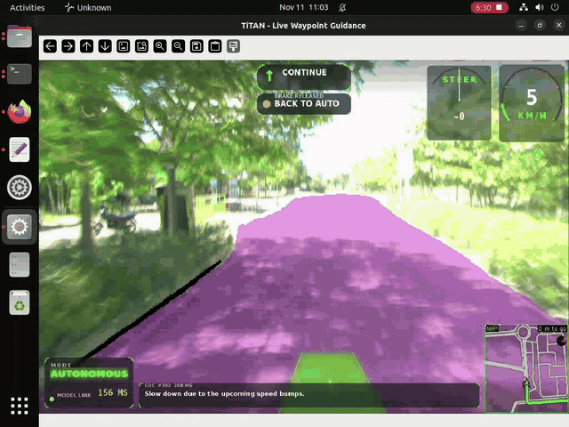

# Chain-of-Causation (CoC) Reasoning for Autonomous Driving

<p align="center">
  
  <br>
  <em>Live CoC reasoning on the TiHAN testbed vehicle in autonomous mode (11 Nov 2026). The bottom bar shows the model's driving decision and reason, e.g. "Slow down due to a cone blocking the lane ahead." and "Stop because of a pedestrian crossing the road."</em>
  <br>
  ▶️ <a href="media/testbed_coc_demo.mp4"><b>Watch the full 2-minute result clip (MP4)</b></a>
</p>

**Chain of Causation (CoC)** is a structured reasoning and annotation framework used by Vision-Language-Action (VLA) models, such as NVIDIA's Alpamayo and CoC-VLA architectures. It links what the car sees directly to the driving decision it takes: *decision → because → visible cause*.

This repository contains a **Qwen3-VL-2B** vision-language model fine-tuned for CoC reasoning on **Indian roads**. From four front-camera frames, it writes one sentence that gives the driving decision and the reason for it:

> **"Slow down due to the lead vehicle ahead."**
> **"Stop because of a pedestrian crossing the road."**
> **"Maintain speed due to clear lane ahead."**

The model can also answer free-form driving questions in the LingoQA style, and it runs in real time on the vehicle at about 2 answers per second.

| | Base Qwen3-VL-2B | **Final CoC model** |
|---|:---:|:---:|
| **LingoQA** (Lingo-Judge, 500 val Q) | 46.2 | **73.2** |
| "Speed bump" hallucinations (Hyderabad, vehicle setup) | 33% (72.2 model) | **0%** |
| Latency per answer (A40 GPU) | – | **0.4–0.6 s** |

> ⚠️ **Advisory only.** The model explains the scene. It must never be used to steer, brake or accelerate a vehicle.

📄 **Full documentation** (method, architecture, deployment, results and IEEE references): download [`CoC_73p2_documentation.html`](CoC_73p2_documentation.html) and open it in a browser.

---

## How it works

```
 4 front-camera frames  ──►  Qwen3-VL-2B vision encoder  ──►  vision-language merger  ──►  Qwen3 LLM decoder  ──►  "Decision + reason"
 (oldest → newest,           (bf16)                                                     (+ merged LoRA)          e.g. "Slow down due to
  last frame = now)                                                                                                the lead vehicle ahead."
```

- **Input:** 4 frames ending at the decision moment, plus a fixed CoC prompt. The model gets no speed, trajectory or CAN data. It works out the ego vehicle's own motion from how the scene moves across the frames.
- **Output:** one CoC sentence, produced with greedy decoding so the result is deterministic.
- **Vehicle setup:** frames 0.1 s apart (10 Hz). Frames 1–3 are 256×144 and the last frame is 512×288, which keeps the prompt to about 619 tokens. Inference runs in a background thread so the video feed never freezes.

## Model lineage

| Stage | What was done | LingoQA |
|---|---|:---:|
| Qwen3-VL-2B-Instruct | base model | 46.2 |
| `coc_student_alpamayo` | full fine-tune on Indian CoC data (Alpamayo-style CoC labels) | 68.6 |
| `merged_rft_ck500` | + LoRA, **rejection-sampling fine-tuning (RFT)**: 8,190 of the model's own Lingo-Judge-approved answers + 3,000 CoC samples | 72.2 |
| **`merged_sbfix_ck1500`** | + LoRA on **speed-bump-cleaned** data (16,000 CoC + 8,190 RFT samples) | **73.2** |

**Speed-bump fix.** The original model said "speed bump" in up to 57% of its answers. To find out why, **Qwen3.5-27B** checked all 7,554 CoC training answers that mention a speed bump. It saw a bump in only **79 of them (1%)**, so **7,475 wrong labels were removed** and the speed-bump share of the data fell from 12.1% to 0.14%.

LoRA settings: r=64, alpha=128, dropout 0.05, LLM layers only, lr 2e-5, global batch 16, 1 epoch.

## Results

### LingoQA

500 validation questions, scored with Lingo-Judge and greedy decoding.

| Checkpoint (sbfix LoRA) | 150 | 600 | 1050 | 1200 | 1350 | **1500** | final |
|---|:---:|:---:|:---:|:---:|:---:|:---:|:---:|
| LingoQA | 71.2 | 72.0 | 72.2 | 72.8 | 73.0 | **73.2** | 72.4 |

**Determinism check:** the 72.2 model was run **100 times** and scored 72.2 every time, with all 500 answers identical in every run.

### Fewer "speed bump" hallucinations on real drives

Share of answers that mention a speed bump (72.2 model → final model):

| Video | Training setup | Vehicle setup |
|---|:---:|:---:|
| Hyderabad city | 43% → **1%** | 33% → **0%** |
| TiHAN test track | 52% → **10%** | 57% → **17%** |

The model now gives more balanced decisions. In the Hyderabad vehicle setup, the split moved from 74% stop/slow and 26% keep to **52% stop/slow and 48% keep**.

### Real-time performance

**0.4–0.6 s per answer** on an NVIDIA A40 (vehicle setup), which is about 2 CoC decisions per second.

More detail is in [`results/`](results/): `BENCHMARK_summary.txt`, `lingoqa/`, `speed_bump_cleanup/` and `video_tests/` (per-window answer CSVs).

## Repository layout

```
code/training/          train_24coc.py, merge_lora.py, LoRA + RFT Slurm jobs
code/data_cleaning/     Qwen3.5-27B speed-bump label check + cleaned data builder
code/evaluation/        LingoQA, WaymoQA, spatial benchmarks, repeat runs, video tests
deployment/             real-time scripts: live_coc_single.py (CoC overlay), live_camera_vqa.py (Q&A)
results/                LingoQA scores, cleanup summaries, video test results
checkpoint/             LoRA adapter config, trainer state and training logs (no weights)
model/merged_sbfix_ck1500/   config, tokenizer and chat template (no weights)
media/                  result clip + README preview
COMMANDS.txt            every command to install, run, evaluate and retrain
OVERVIEW_SUMMARY.txt    short project summary
```

> **Weights are not in this repository.** `model.safetensors` (4.0 GB), the LoRA `adapter_model.safetensors` and the optimizer state are shared separately. To use the model, put `model.safetensors` into `model/merged_sbfix_ck1500/`.

## Quick start (real-time testing)

```bash
python3 -m venv ~/coc_live && source ~/coc_live/bin/activate
pip install torch torchvision                     # CUDA build matching your driver
pip install -r deployment/requirements_live.txt   # transformers >= 5.0

python3 deployment/live_coc_single.py                       # webcam 0
python3 deployment/live_coc_single.py --source drive.mp4    # recorded video
python3 deployment/live_coc_single.py --source rtsp://<camera-ip>/stream
python3 deployment/live_coc_single.py --source drive.mp4 --no_display --out_video drive_coc.mp4   # headless
python3 deployment/live_camera_vqa.py --source 0            # ask driving questions live
```

Minimal Python usage:

```python
from transformers import AutoModelForImageTextToText, AutoProcessor
m = AutoModelForImageTextToText.from_pretrained("model/merged_sbfix_ck1500", dtype="bfloat16").to("cuda").eval()
p = AutoProcessor.from_pretrained("model/merged_sbfix_ck1500")
content = [{"type": "image", "image": img} for img in four_pil_frames] + [{"type": "text", "text": COC_PROMPT}]
x = p.apply_chat_template([{"role": "user", "content": content}], tokenize=True, add_generation_prompt=True,
                          return_dict=True, return_tensors="pt").to("cuda")
y = m.generate(**x, max_new_tokens=96, do_sample=False)   # greedy decoding is required
print(p.batch_decode(y[:, x["input_ids"].shape[1]:], skip_special_tokens=True)[0])
```

`COC_PROMPT` is the exact `PROMPT` string in `deployment/live_coc_single.py`. Do not change it.

## Known limitations

- On the test track and campus roads, the model sometimes calls yellow-black kerbs a "speed bump" (10–17% of answers). It sometimes also says "sharp curve" on a straight road. These roads are not in the training data.
- A test-track LoRA (`lora_ttfix_v1`) brought these errors to 0%. However, it lowered LingoQA to 71.4 and made the model less cautious in the city, so it was not chosen.
- Next step: record clean camera video (no overlay) of the campus route and add labelled windows to the training data.
